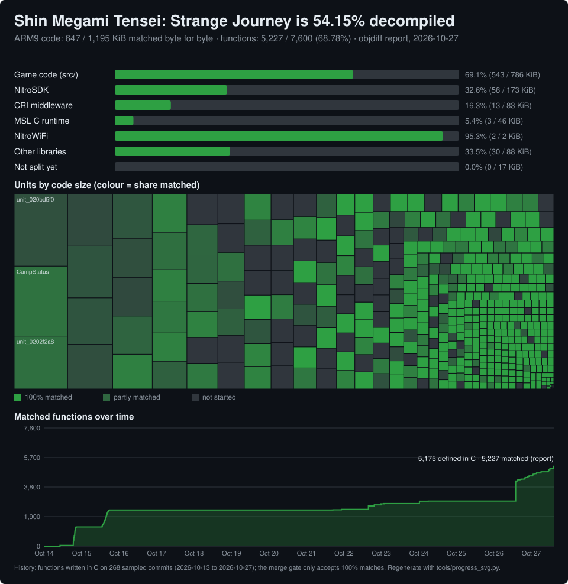

# Preface
This project is an experiment regarding AI reverse engineering using Claude, Codex, Deepseek and Grok working in tandem with one another. God willing this produces something usable, I would very much like the OG Strange Journey to be preserved.

# Shin Megami Tensei: Strange Journey (NDS) decompilation

A work-in-progress matching decompilation of *Shin Megami Tensei: Strange Journey* for the Nintendo DS
(USA, `BMTE`). C sources in `src/` compile with the original Metrowerks toolchain (mwccarm 2.0/sp1p5) back into
byte-identical ARM9 code, split and linked with [ds-decomp](https://github.com/AetiasHax/ds-decomp) (`dsd`) and
measured with [objdiff](https://github.com/encounter/objdiff).

## Progress



**54.15%** of ARM9 code (647 / 1,195 KiB) and
**68.78%** of functions (5,227 / 7,600) match the original
byte for byte (objdiff report, 2026-10-27).

| part | code matched | KiB |
| --- | ---: | ---: |
| Game code (src/) | 69.1% | 543 / 786 KiB |
| NitroSDK | 32.6% | 56 / 173 KiB |
| CRI middleware | 16.3% | 13 / 83 KiB |
| MSL C runtime | 5.4% | 3 / 46 KiB |
| NitroWiFi | 95.3% | 2 / 2 KiB |
| Other libraries | 33.5% | 30 / 88 KiB |
| Not split yet | 0.0% | 0 / 17 KiB |

The chart shows each category's matched share, a treemap of every translation unit sized by code and coloured by
how much of it matches, and matched functions over time. Regenerate it with `python3 tools/progress_svg.py`
after `ninja` and `./objdiff-cli report generate -o build/report.json`.

## This repository contains no game data

No ROM, no extracted assets, no compiler and no build output are included. You need your own legally obtained
copy of the game. `.gitignore` keeps `*.nds`, `baserom.nds`, `extract/`, `build/`, `dsd`, `objdiff-cli`,
`tools/wibo` and `tools/mwccarm/` out of git; please keep it that way in pull requests.

## Building

Requirements: x86_64 Linux (or WSL), Python >= 3.11, git, ninja, `arm-none-eabi-binutils`.

```sh
python3 tools/download_tools.py          # fetches pinned dsd, objdiff-cli, wibo and mwccarm (config/toolchain.toml)
tools/setup_local.sh /path/to/SMTSJ.nds  # verifies your ROM, links it as baserom.nds, extracts, configures and builds
# or step by step, once baserom.nds exists:
./dsd rom extract --rom baserom.nds --output-path extract
python3 configure.py
ninja
python3 tools/checksum.py                # confirms the rebuilt modules are byte-identical
```

`config/target.toml` lists the expected ROM SHA-1. `objdiff.json` (generated by `configure.py`) can be opened in
the objdiff GUI to compare functions.

## Contributing

- Pick an unmatched function: `python3 tools/decompme.py list` (smallest first).
- Make a [decomp.me](https://decomp.me) scratch: `python3 tools/decompme.py scratch FUNC --check --dry-run` writes
  the target asm, context and flags locally; see `tools/decompme.py --help`.
- A function is done when objdiff reports 100% and `tools/checksum.py` still passes.

## Layout

| path | contents |
| --- | --- |
| `src/`, `include/` | decompiled C and headers |
| `config/arm9/` | dsd split config (`delinks.txt`, symbols, relocations) |
| `docs/` | notes, per-unit function documentation |
| `tools/` | build, verification and helper scripts |
